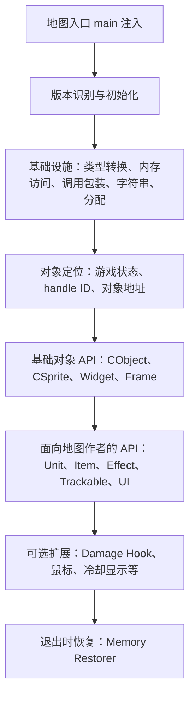

# MemHackAPI 源码结构与调用链

本文是《[入门指南](入门指南.md)》的配套阅读材料，回答两个问题：源码按什么层次组织，以及一次地图 API 调用会经过哪些模块。内容依据 [UnryzeC/MemHackAPI](https://github.com/UnryzeC/MemHackAPI) 当前公开仓库的文件结构整理。为尊重上游未声明许可证的情况，本文提供分析和源码链接，不复制整套源文件。

> 读链路时要分清三种信息：JASS 源码明确做了什么；作者注释声称模块想做什么；某个偏移在游戏内部到底代表什么。前两者能从源码阅读，最后一项需要对应游戏版本的独立结构分析才能确认。变量名和注释本身不是二进制结构证明。

## 一、全局结构

可以把项目理解为四层：



这张图表示依赖方向，不表示每个 API 每次都会调用所有模块。一个简单的包装函数可能只用 `ConvertHandle` 和一个对象方法；一个 hook 则会额外改写游戏入口并需要恢复。

## 二、按模块读源码

| 层次 | 文件或模块 | 主要工作 | 新手应该先问什么 |
|---|---|---|---|
| 编译辅助 | `JassHelper/pjass.exe`、`//! nocjass`、`library` | 由 JassHelper 处理宏、library 和项目使用的扩展语法 | 哪些写法是原生 JASS，哪些依赖编译器？ |
| 基础工具 | `02-APIBasicUtils.j` | 通用小工具、hashtable 等辅助能力 | 这个 helper 的输入输出是什么？ |
| 类型表示 | `03-APITypecast.j` | 在 JASS 值、整数、实数、布尔值和地址表示间转换 | 这是数值转换，还是把位模式重新解释？ |
| 内存核心 | `04-APIMemory.j` | 版本/模块信息、解锁流程、内存读写、bytecode 执行入口 | 地址如何进入读写路径？失败时返回什么？ |
| 函数调用 | `05-APIMemoryCalls.j` | 生成并调用不同参数个数/调用约定的机器码桩 | 参数放入寄存器还是压栈？返回值如何接回 JASS？ |
| 位运算/字符串 | `06-APIMemoryBitwise.j`、`07-APIMemoryString.j` | 补足 JASS 对位运算和游戏内字符串处理的需要 | API 收的是 JASS 字符串还是地址？编码/寿命是什么？ |
| 系统与分配 | `08-APIMemoryKernel.j`、`10-APIMemoryStormDLL.j`、`11-APIMemoryMPQ.j` | 通过已解析入口调用系统/Storm 能力，并管理内存区 | 地址从哪里来？内存权限如何变化？ |
| 清理 | `09-APIMemoryRestorer.j` | 记录写入前的值，在退出路径恢复改动 | 谁登记了修改？退出时是否能走到恢复函数？ |
| 游戏数据 | `12-APIMemoryFrameData.j`、`13-APIMemoryGameData.j` | 定位 UI/游戏状态，并把 JASS handle 转为内部对象地址 | 转换使用哪些版本相关结构？零值如何处理？ |
| 游戏 UI 基础 | `14-APIMemoryGameUI.j`、`15-APIMemoryGameUIButton.j`、`16-APIMemoryGameWindow.j` | 访问 GameUI、按钮和窗口相关数据 | 这个地址是句柄、对象还是全局结构？ |
| Frame 类型 | `20-MemHackConstantsAPI.j`、`22` 到 `42` 系列 `C*FrameAPI` | 按 `CFrame`、`CSimpleFrame`、`CTextFrame` 等类型提供方法 | 子类型是否依赖基类初始化？ |
| Frame 易用层 | `43-MemHackFrameAPI.j`、`45-MemHackUIAPI.j` | 把底层 frame 操作整理成创建、定位、文本、尺寸等 API | 一个整数 frame 地址从哪里取得？ |
| 渲染对象 | `48-CSpriteBase`、`49-CSpriteMini`、`50-CSpriteUber`、`52-CObject` | 对对象、sprite、模型、颜色、位置、动画等提供底层操作 | 方法属于通用对象还是特定 sprite 类型？ |
| 游戏对象族 | `55` 到 `83` 系列 Player、Ability、Widget、Item、Unit、Group、Effect、Trackable、Mouse API | 将底层对象能力包装成面向地图脚本的 API | 这个 wrapper 复用了哪一层？是否只是转发？ |
| 入口和示例 | `85-InitMemoryHack.j`、`87-InitMemoryHack.j`、`88-InitMainHook.j`、`2-Misc_Examples` | 初始化顺序、主函数注入和示例调用 | 哪个函数先执行？该模块是否可选？ |
| 修改游戏行为的 hook | `3-Hooks`、`Addons` | 在特定函数路径插入自定义行为，或加入附加组件 | 原始入口是否保存？异常/退出时如何恢复？ |

不同编号可能有相近名称或重复版本。不要只看文件编号判断新旧或加载顺序；以初始化入口实际调用的函数为准。

## 三、逐条看懂关键链路

### 链路 1：地图启动到 MemHack 初始化

**入口：** [`88-InitMainHook.j`](https://github.com/UnryzeC/MemHackAPI/blob/main/MapFiles/trigger/1-MemoryHack%20API/88-InitMainHook.j)

```text
编译器把注入片段放进 main
  -> InitTrig_InitMemoryHack()
  -> CreateAllUnits() / CreateAllItems()
  -> main2()（地图自己的初始化示例）
```

这段注入的目的，是让 MemHack 初始化位于地图常规对象创建和自定义初始化之前。源码注释特别提醒不要把其他逻辑放到 MemHack 执行之前。`main2` 是示例里保存或重命名后的地图初始化函数，不是 MemHack 的核心算法。`//! inject main` 等标记是编译工具链指令，不是运行时 JASS 函数。

**阅读时检查：** 插入点究竟位于生成的 `main` 哪一段；地图原有 `main` 逻辑是否被保留；初始化失败后地图是否仍继续调用依赖 API 的代码。

### 链路 2：解锁入口、等待与版本门控

**入口：** [`04-APIMemory.j`](https://github.com/UnryzeC/MemHackAPI/blob/main/MapFiles/trigger/1-MemoryHack%20API/04-APIMemory.j)、[`85-InitMemoryHack.j`](https://github.com/UnryzeC/MemHackAPI/blob/main/MapFiles/trigger/1-MemoryHack%20API/85-InitMemoryHack.j)

```text
InitTrig_InitMemoryHack
  -> 通过项目使用的 ForForce/JASS 函数表示技巧调用 UnlockMemory
  -> 启动短延时计时器
  -> Init_MemoryHack
  -> 检查 PatchVersion
  -> 按序调用核心模块和功能模块
```

`UnlockMemory` 和 `ForForce(... I2C(C2I(function UnlockMemory) + 0x8))` 是依赖特定 JASS 编译/运行行为的项目技巧，不能当成普通回调用法。后面的计时器把主体初始化推迟约 0.05 秒。随后 `Init_MemoryHack` 先检查 `PatchVersion`；识别不到支持版本时走“不支持版本”分支，不应假定地址表已经可用。

上游的两个初始化文件 `85`、`87` 有相似内容。分析具体构建时应确认地图实际编入的是哪一份，不要把两份都视为必然执行。

## 四、源码中能解析到哪些结构

这里的“结构解析”是从源码读出字段访问、表的组织方式和模块间传递的数据，不等于已经确认 Warcraft III 的 C++ 结构定义。下面区分源码能直接证明的内容和仍需外部证据的部分。

| 结构 | 源码中可见的组织方式 | 可以得出的结论 | 不能仅凭源码确认的内容 |
|---|---|---|---|
| `MemHackTable` | JASS hashtable；常见 key 是 `StringHash(类别)` + `StringHash(名称)` | 项目自己的命名地址注册表，例如按 `CUnit/Redraw` 保存版本相关函数地址 | 它不是游戏原生对象表或连续内存结构 |
| Handle 查找路径 | `ConvertHandle` 调 `GetHandleId`；`ConvertHandleId` 从 `GetGameStateInstance()` 连续解引用，并用 `handleid * 0xC` 与常量计算条目位置 | 这是代码实际采用的句柄查找算法；每个 `ReadRealMemory` 都表示一次读取/解引用 | 中间节点的真实类名、`0xC` 条目的字段含义、内存表容量 |
| 普通对象首 DWORD | `GetAgentType` 读取对象首地址后再访问 `+0x1C`；CSprite API 读取首 DWORD 并与已登记的 vtable 地址比较 | 代码把首 DWORD 当作类型识别依据之一 | 所有对象是否共用标准 C++ vptr 布局、该布局是否跨版本稳定 |
| Sprite 子类型与坐标 | [`48-MemHackCSpriteBaseAPI.j`](https://github.com/UnryzeC/MemHackAPI/blob/main/MapFiles/trigger/1-MemoryHack%20API/48-MemHackCSpriteBaseAPI.j) 通过首 DWORD 区分 `CSpriteMini`/`CSpriteUber`；Mini 的 X/Y 使用 `+0x88/+0x8C`，Uber 使用 `+0xC0/+0xC4` | 代码会按其识别到的类型选不同偏移读写坐标 | 不能把偏移推广到其他对象类型、补丁版本，也不能只靠变量名推断完整布局 |
| Native Hook 缓冲区 | `RJassNativesBuffer` 每组三个整数存槽地址、旧地址、新地址；`RJassNativesBufferSize` 记录组数 | 这是 MemHack 自己的 hook 位置缓存，供后续复用 | 它不是游戏 native 表本身；native 节点的结构是代码运行时按偏移遍历的 |
| Restorer 记录 | `MemRestorerArray` 存长度；`MemRestorerArrayAddr` 与 `MemRestorerArrayValue` 按序号存地址和原 DWORD | 三组 hashtable key 共同组成一个逻辑数组，恢复循环从末项向前写回 | 它不是所有写入自动进入的全局事务日志 |
| Frame/FDF 注册信息 | `CFrame`、`CFrameAPI` 等类别下保存创建/查找函数和若干全局地址 | 这是按用途分组的地址注册；Frame API 取地址后经调用包装器调用 | 名称如 `FDFHashList` 是代码命名，字段布局和对象生命周期仍需要对应版本证据 |

### 两个结构解析例子

**例 1：拆开 `ConvertHandleId` 的嵌套读取。** 把一行嵌套表达式写成中间步骤，更容易看懂指针流向：

```text
p0 = GetGameStateInstance()
p1 = ReadRealMemory(p0)
p2 = ReadRealMemory(p1 + 0x1C)
p3 = ReadRealMemory(p2 + 0x19C)
entry = p3 + handleid * 0xC - 0x2FFFFF * 4
object = ReadRealMemory(entry)
```

这是对源码的等价拆分，不是已经验证的 C++ 结构图。稳妥的说法是：“从登记的 GameState 基址沿指针关系定位一张表，按 handle ID 和 `0xC` 步长算出条目，再读出一个 DWORD。”要给 `p1/p2/p3` 命名，或说明常量对应哪个字段，必须有特定游戏版本的结构证据。

**例 2：Sprite 坐标的类型分支。** `GetSpriteBaseX` 先用 `GetSpriteBaseType` 读取对象首 DWORD，并与 Mini/Uber 的 vtable 地址比较；识别为 Mini 时使用偏移 `0x88`，识别为 Uber 时使用 `0xC0`，随后读取 `base + offset` 处的实数。这个链路解释了“源码如何选偏移”，不代表其他对象也能套用这些偏移。

阅读类似结构时，逐个标出 `ReadRealMemory` 解引用、`base + offset` 相对位置、版本分支、hashtable key 和最终调用；把未知字段语义留在“待验证”栏，不要用猜测补齐。

### 链路 3：核心模块依赖顺序

**入口：** `Init_MemoryHack` 中的一系列 `call Init_...`，见 [`85-InitMemoryHack.j`](https://github.com/UnryzeC/MemHackAPI/blob/main/MapFiles/trigger/1-MemoryHack%20API/85-InitMemoryHack.j)。

```text
Typecast
  -> APIMemory
  -> APIMemoryCalls
  -> Bitwise / String / Kernel / Storm 等辅助能力
  -> GameData、GameUI、FrameData 等地址基础
  -> CObject / CSprite / CFrame 基础类型
  -> Unit、Item、Ability、Effect、Trackable 等易用层
  -> 可选 Hooks / Addons
```

初始化函数通常把“本版本可用的游戏函数地址”写进 `MemHackTable`。后面的 wrapper 再按 key 取出地址。所以初始化顺序就是依赖顺序：先建通用调用和转换能力，再登记/构造底层对象 API，最后初始化依赖它们的上层 API。注释里写着 `not required` 的功能通常可选，但要同时检查有没有其他模块依赖它。

### 链路 4：JASS 值转换与底层参数准备

**源码：** [`03-APITypecast.j`](https://github.com/UnryzeC/MemHackAPI/blob/main/MapFiles/trigger/1-MemoryHack%20API/03-APITypecast.j)、[`07-APIMemoryString.j`](https://github.com/UnryzeC/MemHackAPI/blob/main/MapFiles/trigger/1-MemoryHack%20API/07-APIMemoryString.j)

```text
JASS unit / string / real / boolean
  -> 项目 helper 转换为底层调用所需的整数或内存地址表示
  -> fast_call / this_call wrapper
```

JASS 的 `real`、`string`、`handle` 并不天然等同于 C/C++ ABI 中的参数。`03-APITypecast.j` 集中处理项目需要的值表示转换；字符串相关模块则负责在游戏环境与内存表示之间转换。追代码时要核对 helper 的具体名称、返回类型和生命周期。尤其不要把“浮点数数值变成整数”与“保留浮点位模式”混为一谈。

### 链路 5：内存读取与写入

**源码：** [`04-APIMemory.j`](https://github.com/UnryzeC/MemHackAPI/blob/main/MapFiles/trigger/1-MemoryHack%20API/04-APIMemory.j)

```text
上层传入地址
  -> ReadRealMemory / WriteRealMemory 等封装
  -> 按项目建立的内存访问机制读取或写入
  -> 返回整数/完成写入
```

该文件同时包含对齐读取、安全读取和写入等不同 helper。带 `Safe` 的版本和普通版本处理未对齐地址的方式并不相同；应直接比较函数体，不要只按名字认为它们有完整的边界检查。`PatchMemory` 系列还可能临时修改页保护，再恢复原保护。

地址为 `0` 往往作为无效值处理，但“非零”并不自动证明它是可读、可写或属于正确对象的地址。

### 链路 6：JASS Native Hook 与 bytecode 执行

**源码：** [`04-APIMemory.j`](https://github.com/UnryzeC/MemHackAPI/blob/main/MapFiles/trigger/1-MemoryHack%20API/04-APIMemory.j)

```text
ExecuteBytecode(memaddr)
  -> 找到用作触发入口的 JASS native 地址
  -> CreateJassNativeHook 建立/复用 native 表位置
  -> 暂时把该位置改指向 memaddr
  -> 调用一个预留的 JASS native 触发执行
  -> 读取返回值
  -> 把原目标地址写回
```

`CreateJassNativeHook` 会遍历项目认为的 native 结构，并记录旧地址、新地址及被改写位置，便于重复使用。`ExecuteBytecode` 在调用前暂时改写目标，调用后恢复原目标。这是这个项目的执行桥梁，不等同于 JASS 语言提供了任意 C++ 函数调用。

这里最值得追的不是机器码，而是四件事：目标地址从哪里来、是否成功找到 hook 位置、调用返回值如何取回、每条退出路径是否都会写回旧值。

### 链路 7：按调用约定调用内部函数

**源码：** [`05-APIMemoryCalls.j`](https://github.com/UnryzeC/MemHackAPI/blob/main/MapFiles/trigger/1-MemoryHack%20API/05-APIMemoryCalls.j)

```text
上层 API 提供 funcaddr 和参数
  -> fast_call_N / this_call_N 等 wrapper
  -> 在已分配的可执行区域写入调用桩和参数
  -> ExecuteBytecode(调用桩地址)
  -> 取回函数返回值
```

文件里的 `fast_call_0`、`fast_call_1` 等会按参数个数布置寄存器和栈参数；`this_call` 家族还涉及对象实例/this 参数。机器码常量是特定 x86 代码的编码。参数个数相同不代表调用约定相同，函数原型或寄存器约定不清楚时，照抄某个 `fast_call_N` 可能造成崩溃或破坏栈状态。

### 链路 8：从 JASS handle 找到游戏对象

**源码：** [`13-APIMemoryGameData.j`](https://github.com/UnryzeC/MemHackAPI/blob/main/MapFiles/trigger/1-MemoryHack%20API/13-APIMemoryGameData.j)

```text
JASS handle h
  -> GetHandleId(h)
  -> GetGameStateInstance() 得到一个版本相关的基准地址
  -> ConvertHandleId(handleid) 沿内存表/指针关系计算条目位置
  -> 读取条目中的对象地址
  -> 返回内部对象指针形式的 integer
```

上层看起来得到的是一个 `integer`，实际用途可能是地址。表达式中的 `0x1C`、`0x19C`、`0xC` 等是该代码使用的偏移和步长；只凭源码不能可靠地给每个节点命名为“对象池”“槽位字段”等。要确认真实结构，必须结合对应游戏版本的二进制/运行证据。

### 链路 9：对象基础操作到 Unit API

**源码：** [`52-MemHackCObjectAPI.j`](https://github.com/UnryzeC/MemHackAPI/blob/main/MapFiles/trigger/1-MemoryHack%20API/52-MemHackCObjectAPI.j)、[`77-MemHackUnitNormalAPI.j`](https://github.com/UnryzeC/MemHackAPI/blob/main/MapFiles/trigger/1-MemoryHack%20API/77-MemHackUnitNormalAPI.j)

```text
SetUnitModel(unit, model, flag)
  -> ConvertHandle(unit)
  -> SetObjectModel(pObject, model, flag)
  -> 字符串/对象地址检查与参数准备
  -> this_call / 对应调用 wrapper
  -> 游戏内部对象方法
```

`SetUnitModel` 是很好的阅读样例：Unit 层只把 JASS `unit` 转成指针并转发；通用对象层负责模型操作细节；最底层调用包装器才负责把参数放到正确 ABI 位置。`SetObjectModel` 实际先读对象首 DWORD，再对读出的值加 `0x88` 并解引用；这与直接访问 `pObject + 0x88` 不同。不要仅凭这个偏移给该位置命名成某个结构字段，除非有外部结构分析支撑。

### 链路 10：Effect / Trackable 等复用对象能力

**源码：** [`70-MemHackEffectAPI.j`](https://github.com/UnryzeC/MemHackAPI/blob/main/MapFiles/trigger/1-MemoryHack%20API/70-MemHackEffectAPI.j)、`71-MemHackTrackableAPI.j`、`48` 到 `50` 的 CSprite 系列。

```text
SetEffectAlpha(effect, alpha)
  -> ConvertHandle(effect)
  -> SetObjectAlpha(pObject, alpha)
  -> CSprite/CObject 底层方法调用
```

Effect API 的许多函数只是把 `effect` handle 转成对象地址，然后复用 CObject/CSprite 的颜色、坐标、缩放、动画或模型方法。Trackable 与 Effect 在项目里复用了部分 sprite 能力；这说明“API 层可共用函数”，不表示所有对象在所有版本中布局都完全相同。

### 链路 11：Frame/UI 创建与操作

**源码：** [`14-APIMemoryGameUI.j`](https://github.com/UnryzeC/MemHackAPI/blob/main/MapFiles/trigger/1-MemoryHack%20API/14-APIMemoryGameUI.j)、[`22-MemHackCFrameAPI.j`](https://github.com/UnryzeC/MemHackAPI/blob/main/MapFiles/trigger/1-MemoryHack%20API/22-MemHackCFrameAPI.j)、[`43-MemHackFrameAPI.j`](https://github.com/UnryzeC/MemHackAPI/blob/main/MapFiles/trigger/1-MemoryHack%20API/43-MemHackFrameAPI.j)、[`45-MemHackUIAPI.j`](https://github.com/UnryzeC/MemHackAPI/blob/main/MapFiles/trigger/1-MemoryHack%20API/45-MemHackUIAPI.j)

```text
定位 GameUI / 现有 Frame
  -> 按 CFrame、CLayer、CSimpleFrame 等类型准备基础方法
  -> CreateFrame / GetFrameByName 等取得 frame 地址
  -> SetFrameText / SetFramePoint / SetFrameSize 等易用操作
```

`14` 更接近游戏 UI 根结构和 GameUI 访问；`22` 及各 `C*FrameAPI` 提供类型基础操作；`43` 将底层调用包装为较易使用的 Frame API；`45` 再提供偏 UI 工作流的封装。需要先有 GameUI 和相应 Frame 类型方法，后面的创建和布局才有依赖基础。

### 链路 12：API 注册表与版本地址

**常见模式：** 各模块中的 `Init_...API`，集中调度见 [`85-InitMemoryHack.j`](https://github.com/UnryzeC/MemHackAPI/blob/main/MapFiles/trigger/1-MemoryHack%20API/85-InitMemoryHack.j)。

```text
PatchVersion
  -> Init_...API 的版本分支
  -> 把函数地址/全局地址写入 MemHackTable
  -> wrapper 用同一组 key 读取地址
  -> 检查为非零后调用
```

`MemHackTable` 是跨模块共享的地址/状态表。初始化负责填表，运行时函数负责查表。读一个 API 时要成对搜索 `SaveInteger` 和 `LoadInteger` 的 key；如果 key 不一致，或者初始化没被调用，wrapper 就拿不到它期待的地址。

### 链路 13：内存修改的登记与退出恢复

**源码：** [`09-APIMemoryRestorer.j`](https://github.com/UnryzeC/MemHackAPI/blob/main/MapFiles/trigger/1-MemoryHack%20API/09-APIMemoryRestorer.j)

```text
经过 ChangeOffsetProtection 的写入路径
  -> AddNewOffsetToRestore 把地址和原 DWORD 存入 MemRestorerArray* 两张表
  -> 初始化退出触发器/退出页面路径
  -> 退出时逆序遍历记录
  -> 临时改变页保护、恢复原值、再还原页保护
```

`ChangeOffsetProtection` 会在改页保护前读取原值并调用 `AddNewOffsetToRestore`；Hook 和常量修改等路径会使用它。`PatchMemory`/`PatchRealMemory` 自己只临时改页保护、写入、再恢复页保护，并不自动登记旧值。因此应沿具体写入点确认是否经过登记路径；直接调用 `WriteRealMemory` 或普通 Patch helper 的改动可能不在恢复列表里。不同进程退出方式也可能影响退出回调是否触发，因此阅读恢复代码不等于证明每种关闭场景都已覆盖。

### 链路 14：Damage Hook 等事件扩展

**源码：** [`3-Hooks/2-MemHackDamageHook.j`](https://github.com/UnryzeC/MemHackAPI/blob/main/MapFiles/trigger/3-Hooks/2-MemHackDamageHook.j)、其他 `3-Hooks` 文件。

```text
读取 CUnit vtable/目标方法地址
  -> 保存原方法并申请栈/可执行内存
  -> 把 vtable 槽位改指向自定义 hook
  -> hook 记录/处理参数并调用原方法
  -> 地图侧 API 读取记录的数据
  -> 退出恢复原槽位和内存
```

这是侵入性比普通 wrapper 更高的链路：它改变了游戏后续调用的路由。分析时要逐项确认目标版本、原方法是否保留、参数/返回约定、重入或并发情况、记录缓冲区边界以及恢复路径。不要只看 hook 的业务效果而忽略被替换的原始函数。

## 五、按领域看上层 API 家族

上层文件很多，不需要逐个从头读。先按共同基类建立索引，再挑一个代表函数追到底：

| API 家族 | 代表模块 | 主要对象/用途 | 常见依赖链 |
|---|---|---|---|
| CObject / CSprite | `52`、`48`、`49`、`50` | 通用显示对象、模型、颜色、位置、变换和动画 | GameData → ConvertHandle/对象地址 → CObject/CSprite → 调用 wrapper |
| Frame 类型 | `22`、`24` 到 `42` | CFrame、Layer、TextFrame、Button、Slider、StatusBar 等细分类型 | GameUI → 对应类型 API → FrameAPI/UIAPI |
| Widget / Item / Unit | `64` 到 `79` | Widget 公共能力以及 Item、Unit 专属属性 | handle 转换 → Widget Base → Item/Unit Base → Normal API |
| Ability | `57`/`59` 到 `63` 中 AbilityAddress、Base、Normal、Unit 系列 | 能力对象定位、基础能力和单位能力操作 | Ability 地址层 → Base/Normal/Unit wrapper |
| Effect / Trackable | `68` 到 `71` | 特效/可交互对象外观和位置等能力 | ConvertHandle → CSpriteUber → 对象方法 |
| Group | `80`/`82` | 组遍历和项目增加的 group 辅助能力 | Group handle/内部函数地址 → 调用 wrapper |
| Player / Timer / Mouse | `55`、`57`、`83`/`85` | 少量特殊玩家数据、TimerRestart、本地鼠标位置 | GameData 或本地 UI 状态 → 相应 wrapper |

文件编号在项目演进中并不总是连续或唯一。实际要看初始化函数名称、被调用的底层符号以及它写入/读取的表 key。

## 六、如何自己追一条没看过的链

以 `SetEffectScale` 为例：

1. 在源码搜索 `SetEffectScale`，记录定义在哪个文件、调用了谁。
2. 跟到 `ConvertHandle(e)`，弄清 JASS handle 如何变成整数形式的内部对象指针。
3. 跟到 `SetObjectScale`，记录它读取的地址 key、参数转换 helper 和调用 wrapper。
4. 跟到 `fast_call_N` 或 `this_call_N`，观察参数进入寄存器/栈的方式和返回值路径。
5. 回到对应模块的 `Init_...API`，找到函数地址按哪些游戏版本登记。
6. 检查这条链的初始化是否发生在调用之前，以及失败时是否检查零地址。
7. 若涉及写内存，检查原值是否登记进 Restorer；若涉及本地状态，检查同步影响。

建议每条链都用同一张笔记表：

| 项目 | 记录内容 |
|---|---|
| 公开入口 | 地图作者调用的函数和参数 |
| 转换步骤 | handle、string、real、boolean 如何变成底层表示 |
| 地址来源 | 初始化函数、版本分支、hashtable key |
| 调用方式 | 普通 wrapper、this-call、native hook 或其他机制 |
| 返回路径 | 底层结果如何转成 JASS 的返回值 |
| 失败条件 | 零地址、空对象、版本不支持、分配失败等 |
| 清理责任 | 是否有原值登记、对象释放或 hook 恢复 |
| 未知项 | 需要二进制、运行或结构证据确认的事实 |

## 七、读完这一份后从哪里继续

1. 从 `88-InitMainHook.j` 看控制流入口。
2. 从 `85-InitMemoryHack.j` 看实际初始化顺序和可选模块。
3. 在 `04-APIMemory.j` 看读写与 bytecode 执行桥梁。
4. 在 `05-APIMemoryCalls.j` 比较不同调用约定的参数安排。
5. 在 `13-APIMemoryGameData.j` 看 handle 到对象的转换。
6. 选 `52-CObject`、`70-Effect` 或 `77-Unit` 中一个短 API，按上面的笔记表从入口追到底。
7. 最后读 `09-APIMemoryRestorer.j` 和一个 Hook 文件，理解修改与清理的完整生命周期。

学习目标不是背下某个地址，而是能说清每个 API 的依赖、数据如何流动、调用如何发生、失败在哪里，以及哪些结论仍缺少证据。
